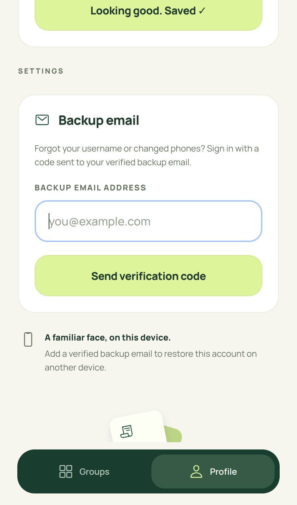
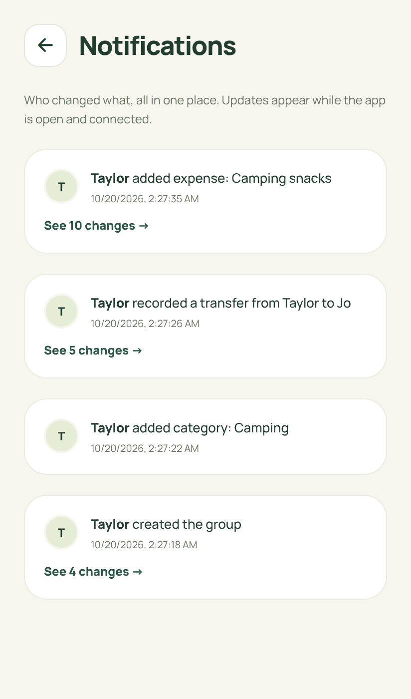

# SplitBill

A simple Android app for shared bills. Add a bill or transfer, see everyone’s signed balance, and settle up. No itinerary, subscription or Google sign-in.

## Android app

Get the standalone APK from [Releases](https://github.com/DIVYANSH-675/splitly/releases). Choose **arm64-v8a** for most current Android phones; **armeabi-v7a** is for older 32-bit phones. Expo Go is not required. These are preview builds, not Play Store releases.

The app uses the dedicated **SplitBill Supabase project** by default. It works without a local computer. First-time username registration, joining an unfamiliar group and exports need a connection. Once signed in, your saved groups and pending changes remain available offline.

 

## Features

- Start with a name and unique username. No email, password or Google account is required to start. An optional verified backup email supports passwordless recovery. The device securely retains an access token; knowing a username alone does not grant access.
- Create a group with friends’ names. Join using an invite code or scan its QR code. An offline-created group receives its real invite code after syncing.
- Add bills with equal, exact, percentage or weighted shares; multiple payers are supported.
- Choose a trip category or add a permanent category shared with the group.
- Optionally attach up to three JPG, PNG, WebP or PDF files per bill, each up to 2 MB. Files are saved on the device before upload and require group membership to download.
- Record transfers separately: balances change, expense totals do not.
- Green **+** means money to receive; red **−** means money owed; zero is neutral.
- Open the notification bell for a full page showing who changed what, with timestamps and before/after details. This is an in-app history page; background push is not configured.
- Authors edit/delete their own entries. The creator is the group admin and can edit/delete anyone’s entries. The server enforces these permissions.
- View category graphs and each person’s share on the group page without another analytics app or large chart library.
- Set an optional profile photo. Images are resized to 192 pixels before saving.
- Export PDF and XLSX from Group options. PDF uses an expense ledger with date/time, description, payer, per-member shares, totals and settlements. Notification history is excluded from PDF; graphs are optional. XLSX has numeric money cells and detailed financial sheets, plus Activity.

Built-in categories: Food & drinks, Travel, Stay, Activities, Groceries, Fuel, Shopping, Tickets, Rentals, Fees & tips, Health, Bills and Other. Custom categories belong to a group.

## Offline behavior

The installed Android bundle starts without the development server. After the initial online registration, cached groups open offline. Bills, attachments, transfers, custom categories, group creation/renaming, guest member edits, profile changes and confirmed bill/transfer edits/deletions are durably queued before the app acknowledges saving them.

New offline bills appear separately and are excluded from confirmed totals until accepted. Other pending group changes are previewed with a waiting-to-sync label. Refreshing the server cache does not discard the mutation queue. Reconnection, foregrounding and periodic retries sync while the app is open. Request IDs prevent a lost response from duplicating a bill, transfer or group.

Validation or permission failures stay visible for retry or discard. A username chosen during a profile edit may be rejected if another person has taken it. Joining an uncached group and exporting server-confirmed reports require the network; the app cannot retrieve unknown group data offline. Sync does not run after the app is closed. The localhost browser preview is not an offline PWA.

Keep app data until queued changes sync. Clearing data loses drafts and device-only account access. Usernames are identifiers, not recovery credentials. Email recovery requires a previously verified backup address and an Internet connection. Delivery must be configured as described below; a username alone cannot restore access. Signing out is blocked while changes remain queued.

## Run locally

Node.js **22.13+** is required (CI uses 22.22.1).

```bash
npm ci
npm --prefix mobile ci
npm run dev
```

- Preview: `http://localhost:8081`
- Local API: `http://localhost:4310/api/health`
- `npm run dev:mobile` starts the mobile development server without opening a browser.
- Ctrl+C stops both launcher processes.

Web development defaults to the local SQLite API to preserve existing demo data. Android defaults to the hosted Supabase Edge API. Set `EXPO_PUBLIC_API_URL` in `mobile/.env` to override it. Connection settings on the welcome page can select another API; a saved address takes precedence. Existing Android package and device storage keys are preserved across the rename.

## Cloud architecture

Project: `gomowueeizpwzzbqugod` in the dedicated **SplitBill** organization, Singapore region.

- `supabase/migrations/20261019204540_splitbill_core.sql`: private `splitbill` schema for users, profiles, hashed sessions, groups, idempotency records and attachments. RLS is enabled on all app tables. A second migration adds private backup-email and verification-challenge tables. Anonymous/authenticated Data API roles have no direct access.
- `server/core.mjs`: shared API authorization and validation. Every protected request validates its opaque session, then group membership. Creator/admin checks apply to writes.
- `supabase/functions/splitbill-api/index.ts`: generated Edge deployment using the same finance, audit and report code as the local API. Database credentials are available only on the server. The mobile bundle has no service-role key or database password.
- Edge transactions serialize ledger changes with a database advisory lock so concurrent requests cannot overwrite each other’s balances/history. This deliberately simple deployment targets small groups; higher request volumes should partition locking and group storage.
- Attachments are private database records rather than public URLs. They consume database quota; review free-plan usage and retain backups before production use.

To regenerate and deploy after changing server code:

```bash
node scripts/build-edge.mjs
supabase functions deploy splitbill-api --project-ref gomowueeizpwzzbqugod
```

The function uses custom device-session authentication (`verify_jwt = false` for the legacy Supabase gateway check). Membership and author/admin validation happen inside the API. Deploy the migration before the function when provisioning another project. The current project’s schema was applied through its dashboard and verified there.

Local SQLite defaults to `data/memogo.sqlite` for compatibility. Override with `SPLITLY_DB` or change `PORT`. Existing local data is preserved. The five existing groups and their device identities were also migrated into the private cloud project; local SQLite remains a separate development snapshot.

## Backup email delivery setup

Settings → Backup email verifies an address before it can recover an account. The welcome screen’s **Sign in with backup email** requests a code, then restores the same user ID, username, groups and admin rights after verification. Codes are single-use; an email address alone never grants access. Verification requires the network and is not queued offline.

The recovery routes and UI are implemented and covered by tests with an injected OTP provider. **Public email delivery is not configured on this preview project.** Supabase’s free default email service is restricted to team addresses, uses default sign-in links, and does not permit editing those templates. Do not mark delivery ready until the following setup is complete:

1. In Supabase Authentication → Emails → SMTP Settings, configure a transactional email provider and its verified sender.
2. Set both **Confirm sign up** and **Magic link or OTP** templates to include `{{ .Token }}`. Ready-to-use subject/body examples are in `docs/email-templates/`.
3. Set Edge secret `SPLITBILL_EMAIL_OTP_READY=true` only after testing delivery and code verification. The runtime already provides `SUPABASE_URL` and `SUPABASE_ANON_KEY`. Local development requires these variables too.
4. Test adding a backup email, signing out, and recovering the same account from another device. Check rate limits and spam delivery.

Until configured, adding a backup email returns a clear setup message and does not send a link that the code-entry screen cannot use. No SMTP password, service role key, real email code or recovery token belongs in this repository.

## Android builds

[Android APK workflow](.github/workflows/android.yml) runs tests, typecheck and lint, generates the native project, and builds separate ARM64/ARMv7 APKs. R8 minification, resource shrinking and bundle compression are enabled to reduce download size. Native Android/iOS directories are generated and not committed.

The repository variable `EXPO_PUBLIC_API_URL` chooses the backend at build time. Preview builds use a generated debug signing key. Production signing, a stable release key, Play Store submission, operational backups and physical-device acceptance testing need separate setup. `mobile/eas.json` also provides EAS build profiles.

## Verification

```bash
npm test
npm --prefix mobile run typecheck
npm --prefix mobile run lint
cd mobile
npx expo-doctor
npx expo export --platform android --platform web --max-workers 2
```

See [VALIDATION.md](VALIDATION.md) for exact completed checks and remaining device-level limits. Tests cover rounding/splits, permissions, private attachments, shared categories, username uniqueness, transfers, audit changes, durable queue behavior, offline projections, idempotent writes and financial export reconciliation.

## Source map

```text
mobile/src/app/             Expo Router pages
mobile/src/components/      Forms, full-page history, analytics, QR, pending changes
mobile/src/lib/             API, finance, cached state, durable queues, files
server/index.mjs            Local SQLite HTTP adapter
server/core.mjs             Shared API permissions and operations
server/audit.mjs            Before/after audit snapshots
server/export.mjs           PDF ledger and XLSX reports
scripts/build-edge.mjs      Reproducible dashboard-ready Edge source
supabase/                   Private database migration and Edge Function
.github/workflows/          Standalone Android builds
```

The repository excludes databases, device sessions, `.env` files, build caches and credentials. The GitHub token is not part of the app.

Warm ivory, forest green, lime accents and bundled Manrope. Artwork is drawn in code; no third-party app artwork is copied. Manrope uses the included [font license](server/assets/Manrope-LICENSE.txt). Workflow inspiration: [Kittysplit](https://www.kittysplit.com/en/help).
