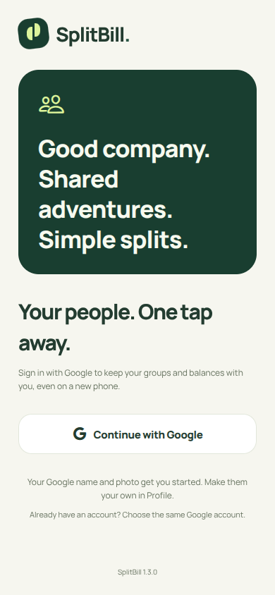
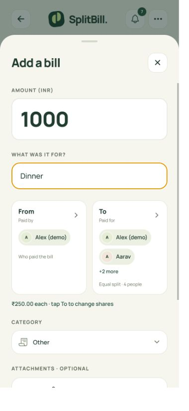
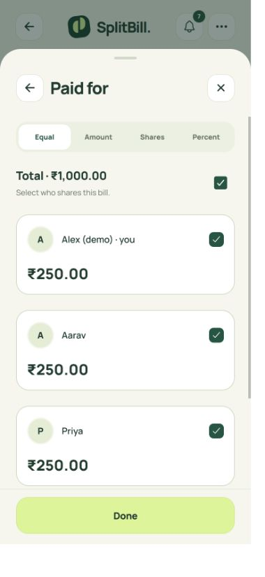
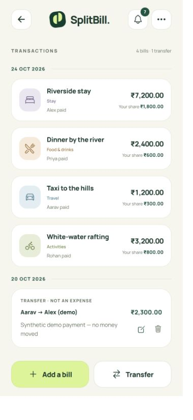

# SplitBill

A simple Android app for shared bills. Add a bill or transfer, see everyone’s signed balance, and settle up. Sign in with Google, split bills, and keep the trip simple. No itinerary or subscription.

## Android app

**Version 1.3.0 APKs are built and verified. Google sign-in is enabled and a real browser login has passed; Android device sign-in remains to be verified.** Download the [1.3.0 preview](https://github.com/DIVYANSH-675/splitly/releases/tag/v1.3.0): [ARM64 APK (36.9 MB)](https://github.com/DIVYANSH-675/splitly/releases/download/v1.3.0/SplitBill-1.3.0-arm64-v8a.apk) or [older 32-bit APK (27.9 MB)](https://github.com/DIVYANSH-675/splitly/releases/download/v1.3.0/SplitBill-1.3.0-armeabi-v7a.apk). Choose **arm64-v8a** for most current Android phones. These are preview builds, not Play Store releases. The package and signing certificate match the previous release: install over it without uninstalling or clearing app data. Old release listings have been retired; source history is retained.

The app uses the dedicated **SplitBill Supabase project** by default. The Google provider and backend are deployed, and the provider credentials have passed a real browser sign-in. The hosted service needs no local computer. First-time Google sign-in, joining an unfamiliar group and exports need a connection. Once signed in, your saved groups and pending changes remain available offline.

 

 

 

## Features

- Continue with Google. New accounts use the verified Google name and photo, plus a unique default username of at most eight characters (for example `jigy4821`). Profile lets you edit your name, photo and username. Reinstalling and signing in with the same Google account restores the same cloud identity and synced groups. User edits survive subsequent Google sign-ins. Existing signed-in users can connect Google in Profile to preserve their old account.
- Create a group with comma-separated names and @usernames, for example `Jigyasu, @priya_27`. Names create unclaimed guests. Valid @usernames link existing accounts after sync, so the group automatically appears for them. Unknown usernames produce a clear sync error.
- Join with an invite code or QR scan, then choose an unclaimed guest name or join as a new member. Claiming keeps the same member ID, previous bills/transfers and balance, and shows your profile name. Connected accounts cannot be claimed; existing bills keep their original authors and permissions. An offline-created group receives its real invite code after syncing.
- Add bills with equal, exact, percentage or weighted shares; multiple payers are supported. Tap the side-by-side **From · Paid by** and **To · Paid for** cards to select people and adjust their amounts. The share picker keeps **Done** visible while you scroll.
- Choose a trip category or add a permanent category shared with the group.
- Optionally attach up to three JPG, PNG, WebP or PDF files per bill, each up to 2 MB. Files are saved on the device before upload and require group membership to download.
- Transactions share one date heading per day, newest dates first. Bill and transfer cards do not repeat the date. Full transaction dates remain available in bill details and exported reports.
- Record transfers separately: balances change, expense totals do not. Side-by-side **From** and **To** cards open single-person selectors.
- Green **+** means money to receive; red **−** means money owed; zero is neutral.
- Open the notification bell for a full page showing who changed what, with timestamps and before/after details. This is an in-app history page; background push is not configured.
- Authors edit/delete their own entries. The creator is the group admin and can edit/delete anyone’s entries. The server enforces these permissions.
- View category graphs and each person’s share on the group page without another analytics app or large chart library.
- Set an optional profile photo. Images are resized to 192 pixels before saving.
- Export PDF and XLSX from Group options. PDF uses an expense ledger with date/time, description, payer, per-member shares, totals and settlements. Notification history is excluded from PDF; graphs are optional. XLSX has numeric money cells and detailed financial sheets, plus Activity.

Built-in categories: Food & drinks, Travel, Stay, Activities, Groceries, Fuel, Shopping, Tickets, Rentals, Fees & tips, Health, Bills and Other. Custom categories belong to a group.

## Offline behavior

The installed Android bundle starts without the development server. After the initial online Google sign-in, cached groups open offline. Bills, attachments, transfers, custom categories, group creation/renaming, guest member edits, profile changes and confirmed bill/transfer edits/deletions are durably queued before the app acknowledges saving them.

New offline bills appear separately and are excluded from confirmed totals until accepted. Other pending group changes are previewed with a waiting-to-sync label. Refreshing the server cache does not discard the mutation queue. Reconnection, foregrounding and periodic retries sync while the app is open. Request IDs prevent a lost response from duplicating a bill, transfer or group.

Validation or permission failures stay visible for retry or discard. A username chosen during a profile edit may be rejected if another person has taken it. Joining an uncached group and exporting server-confirmed reports require the network; the app cannot retrieve unknown group data offline. Sync does not run after the app is closed. The localhost browser preview is not an offline PWA.

Keep app data until queued changes sync. Clearing data loses unsynced drafts. Sign-in requires an Internet connection; after signing in, cached groups and the offline queue continue to work without it. Choose the same Google account after reinstalling. Existing device-only users must connect Google while still signed in; knowing their old username alone cannot recover that identity. Signing out is blocked while changes remain queued. Backup email and name-only registration are no longer available.

## Run locally

Node.js **22.13+** is required (CI uses 22.22.1).

```bash
npm ci
npm --prefix mobile ci
npm run dev
```

- Preview: `http://localhost:8081`
- Local API: `http://localhost:4310/api/health`
- `npm run dev:mobile` starts the mobile development server without opening a browser.
- Ctrl+C stops both launcher processes.

Web development defaults to the local SQLite API to preserve existing demo data. Android defaults to the hosted Supabase Edge API. Set `EXPO_PUBLIC_API_URL` in `mobile/.env` to override it. A previously saved development API address takes precedence; the public welcome screen has no server configuration form. Existing Android package and device storage keys are preserved across the rename.

## Cloud architecture

Project: `gomowueeizpwzzbqugod` in the dedicated **SplitBill** organization, Singapore region.

- `supabase/migrations/20261019204540_splitbill_core.sql`: private `splitbill` schema for users, profiles, hashed sessions, groups, idempotency records and attachments. RLS is enabled on all app tables. Runtime queries assume a non-login role restricted to this private schema. The OAuth identity migration stores the stable Google subject and app user mapping in a private table. Historical backup-email tables are retained for data preservation but no longer used for sign-in. Anonymous/authenticated Data API roles have no direct access.
- `server/core.mjs`: shared API authorization and validation. Every protected request validates its opaque session, then group membership. Creator/admin checks apply to writes.
- `supabase/functions/splitbill-api/index.ts`: generated Edge deployment using the same finance, audit and report code as the local API. Database credentials are available only on the server; app queries run as `splitbill_api`, with bounded statement/lock timeouts. The mobile bundle has no service-role key or database password.
- Edge transactions serialize ledger changes with a database advisory lock so concurrent requests cannot overwrite each other’s balances/history. This deliberately simple deployment targets small groups; higher request volumes should partition locking and group storage.
- Attachments are private database records rather than public URLs. They consume database quota; review free-plan usage and retain backups before production use.

To regenerate and deploy after changing server code:

```bash
node scripts/build-edge.mjs
supabase functions deploy splitbill-api --project-ref gomowueeizpwzzbqugod
```

Apply all migration files in timestamp order when provisioning a fresh project. Runtime-role hardening restricts database privileges; the Google migration adds the private OAuth identity mapping.

The function uses custom device-session authentication (`verify_jwt = false` for the legacy Supabase gateway check). Membership and author/admin validation happen inside the API. Deploy the migration before the function when provisioning another project. The current project’s schema was applied through its dashboard and verified there.

Local SQLite defaults to `data/memogo.sqlite` for compatibility. Override with `SPLITLY_DB` or change `PORT`. Existing local data is preserved. The five existing groups and their device identities were also migrated into the private cloud project; local SQLite remains a separate development snapshot.

## Google sign-in setup

Version 1.3.0 uses Google as its only sign-in method. Google OAuth setup and a real browser/device sign-in must be completed before publishing the APK as ready for use.

1. In the dedicated Google Cloud project `splitbill-512207`, configure the Google Auth Platform consent screen for SplitBill. Request only `openid`, email and profile scopes. Set the audience appropriately for intended users.
2. Create a **Web application** OAuth client with authorized redirect URI `https://gomowueeizpwzzbqugod.supabase.co/auth/v1/callback`.
3. Enable the Google provider in the matching Supabase project and save the client ID and secret there. Never put the secret in this repository or the mobile app.
4. Add these Supabase redirect allow-list entries: `splitly://auth/google**` for the Android app and `http://localhost:8081/auth/google**` for the local web preview. The trailing wildcard permits the random callback state. Add only explicitly used development origins; remove unused development entries before a public production deployment.
5. Apply `supabase/migrations/20261019214431_google_signin.sql`, then generate the tested Edge Function with `node scripts/build-edge.mjs` and deploy it. Keep legacy gateway JWT verification disabled: app sessions are verified inside the API. The OAuth mapping remains private with RLS and the existing restricted runtime role.
6. Test first sign-in (Google name/photo and short username), editing Profile, sign-out/sign-in, and the Android browser return link. Verify a linked legacy account retains its groups and balances.

The app uses a random PKCE verifier and state, a ten-minute pending-login expiry, and server-side code exchange. Only a verified Google identity supplies the account key. Existing user sessions remain valid during migration. Legacy auth endpoints return a clear update message in production; `allowLegacyAuth` exists only for explicit legacy-fixture tests and is not enabled by the server entry point or Edge Function.


## Android builds

[Android APK workflow](.github/workflows/android.yml) runs tests, typecheck and lint, generates the native project, and builds separate ARM64/ARMv7 APKs. R8 minification, resource shrinking and bundle compression are enabled to reduce download size. Native Android/iOS directories are generated and not committed.

The repository variable `EXPO_PUBLIC_API_URL` chooses the backend at build time. Preview builds use a generated debug signing key. Production signing, a stable release key, Play Store submission, operational backups and physical-device acceptance testing need separate setup. `mobile/eas.json` also provides EAS build profiles.

## Verification

```bash
npm test
npm --prefix mobile run typecheck
npm --prefix mobile run lint
cd mobile
npx expo-doctor
npx expo export --platform android --platform web --max-workers 2
```

See [VALIDATION.md](VALIDATION.md) for exact completed checks and remaining device-level limits. Tests cover rounding/splits, permissions, private attachments, shared categories, username uniqueness, transfers, audit changes, durable queue behavior, offline projections, idempotent writes and financial export reconciliation.

## Source map

```text
mobile/src/app/             Expo Router pages
mobile/src/components/      Forms, full-page history, analytics, QR, pending changes
mobile/src/lib/             API, finance, cached state, durable queues, files
server/index.mjs            Local SQLite HTTP adapter
server/core.mjs             Shared API permissions and operations
server/audit.mjs            Before/after audit snapshots
server/export.mjs           PDF ledger and XLSX reports
scripts/build-edge.mjs      Reproducible dashboard-ready Edge source
supabase/                   Private database migration and Edge Function
.github/workflows/          Standalone Android builds
```

The repository excludes databases, device sessions, `.env` files, build caches and credentials. The GitHub token is not part of the app.

Warm ivory, forest green, lime accents and bundled Manrope. Artwork is drawn in code; no third-party app artwork is copied. Manrope uses the included [font license](server/assets/Manrope-LICENSE.txt). Workflow inspiration: [Kittysplit](https://www.kittysplit.com/en/help).
